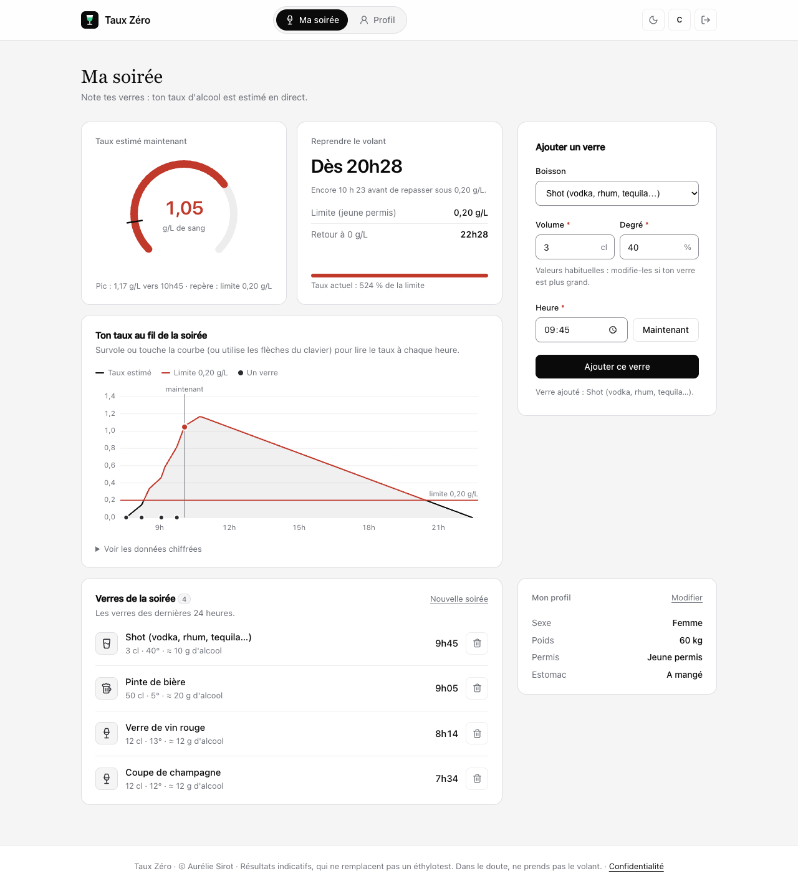

# 🥂 Taux Zéro

[](https://github.com/aurelie-s06/taux-zero/actions/workflows/ci.yml)

Application Next.js qui estime le **taux d'alcool dans le sang** au fil de la soirée.

L'utilisateur crée un compte, répond une seule fois à un court questionnaire (sexe, poids, permis, repas),
puis note ses verres au fil de la soirée (ex. : une coupe de champagne à 20h), choisis dans un catalogue
ou personnalisés. L'application calcule, en direct :

- son alcoolémie estimée, minute par minute ;
- l'heure à laquelle il peut **reprendre le volant** (0,5 g/L, ou 0,2 g/L en permis probatoire) ;
- l'heure à laquelle il revient à **0 g/L** ;
- la **courbe** de son taux au fil de la soirée, avec la limite légale et un repère « maintenant ».

> ⚠️ Les résultats sont **des estimations** (formule de Widmark). Ils ne remplacent pas un éthylotest. Dans le doute, ne prends pas le volant.



## Fonctionnalités

- **Compte utilisateur** : inscription (avec consentement explicite), connexion, déconnexion, suppression du compte
- **Profil** rempli une seule fois et modifiable
- **Verres** : catalogue de 13 boissons ou boisson personnalisée, heure du verre, suppression, « Nouvelle soirée »
- **Résultats en direct** : jauge du taux actuel, pic, heure de reprise du volant, retour à 0 g/L
- **Courbe** du taux, au survol, au toucher ou au clavier, avec ses données chiffrées en tableau
- **Thème clair / sombre**, mobile d'abord, installable sur l'écran d'accueil (manifeste + icônes)
- **Accessibilité** : liens d'accès rapide, erreurs reliées aux champs, graphique lisible au clavier et au lecteur d'écran

## Sécurité et données personnelles

- Mots de passe hachés avec **scrypt** ; sessions par jeton aléatoire dans un cookie `httpOnly` (la base n'en garde que l'empreinte)
- **Limitation des essais** : 5 échecs de connexion par compte et 20 par adresse IP sur 15 minutes, 10 inscriptions par heure et par IP
- Chaque page et chaque action vérifie la session côté serveur : un utilisateur ne peut lire ni modifier que ses propres données
- En-têtes de sécurité (anti-iframe, `nosniff`, `Referrer-Policy`, `Permissions-Policy`)
- **Minimisation** : les verres sont effacés après 48 h, les essais de connexion après 1 h
- Page [Confidentialité](src/app/(info)/confidentialite/page.tsx) : données, durées, cookies, droits

## Stack

- [Next.js 16](https://nextjs.org) (App Router, Server Actions, Cache Components) + React 19
- TypeScript
- CSS classique (même système visuel que mon projet Mon Budget)
- Icônes [Lucide](https://lucide.dev)
- Base SQLite avec `node:sqlite` (intégré à Node 24, aucun paquet à installer)
- Graphique en SVG, sans bibliothèque

## Lancer le projet

Node.js **24 ou plus** est nécessaire.

```bash
npm install
npm run dev
```

Puis ouvrir [http://localhost:3000](http://localhost:3000).

```bash
npm test        # tests (moteur de calcul, boissons, profil, comptes, mots de passe)
npm run lint    # vérification du code
npm run build   # vérifie que le projet compile
```

La base est créée automatiquement au premier lancement dans `data/taux-zero.sqlite` (ignorée par git).
Pour repartir de zéro : arrêter le serveur et supprimer le dossier `data/`.

## Intégration continue (GitHub Actions)

Le workflow [`.github/workflows/ci.yml`](.github/workflows/ci.yml) tourne à chaque `git push` et pull request :

1. **Lint, tests et build** sous Node 24 ;
2. sur `main`, si tout est vert : **construction de l'image Docker** et publication sur le registre
   de GitHub, `ghcr.io/aurelie-s06/taux-zero` (étiquettes `latest` et `sha-xxxxxxx`).

Le résultat se suit dans l'onglet **Actions** du dépôt ; le badge en haut de ce README passe au vert
quand tout va bien.

## Organisation

```
src/
├── app/
│   ├── (app)/           pages réservées aux utilisateurs connectés (Ma soirée, Profil)
│   ├── (auth)/          connexion et inscription
│   ├── (info)/          confidentialité (lisible sans compte)
│   ├── actions/         Server Actions (compte, profil, verres)
│   └── manifest.ts      application installable
├── components/          barre de navigation, jauge, courbe, formulaires…
├── hooks/               useMaintenant (horloge partagée)
├── lib/
│   ├── alcool.ts        moteur de calcul (Widmark)
│   ├── boissons.ts      catalogue des boissons, validation d'un verre
│   ├── compte.ts        validation de l'inscription
│   ├── profil.ts        validation du profil
│   ├── site.ts          informations légales (hébergeur…)
│   └── server/          base de données, sessions, mots de passe, limitation des essais
└── proxy.ts             renvoie vers la connexion sans cookie de session
```

## Mise en ligne

SQLite enregistre les données dans un **fichier** : il faut donc un hébergeur qui garde un disque
entre deux redémarrages (Railway, Render avec un disque, Fly.io, un VPS…). Vercel ne convient pas
tel quel. Le projet fournit un `Dockerfile` qui fonctionne chez tous ces hébergeurs.

### Lancer l'image publiée par GitHub

```bash
docker run -p 3000:3000 -v taux-zero-data:/data ghcr.io/aurelie-s06/taux-zero:latest
```

Une image publiée sur GitHub est **privée** au départ. Pour que n'importe qui (ou un hébergeur)
puisse la télécharger : sur la page du dépôt, **Packages → taux-zero → Package settings →
Change visibility → Public**.

### Construire l'image soi-même

```bash
docker build -t taux-zero .
docker run -p 3000:3000 -v taux-zero-data:/data taux-zero
```

### Exemple avec Railway

1. Sur [railway.com](https://railway.com), **New Project → Deploy from GitHub repo**, choisir `taux-zero`.
   Railway détecte le `Dockerfile` tout seul.
2. Dans le service : **Settings → Volumes → Add volume**, point de montage **`/data`**.
3. Dans **Variables**, ajouter `RAILWAY_RUN_UID=0` (les volumes Railway appartiennent à l'administrateur ;
   sans cette variable, le serveur ne peut pas écrire la base).
4. **Settings → Networking → Generate Domain** pour obtenir l'adresse publique.
5. Compléter le nom et l'adresse de l'hébergeur dans [`src/lib/site.ts`](src/lib/site.ts) (obligation légale),
   puis pousser : Railway redéploie à chaque `git push`.

Variables utiles : `DATABASE_PATH` (chemin de la base, `/data/taux-zero.sqlite` dans l'image), `PORT`.

## Auteure

Aurélie Sirot · projet personnel
